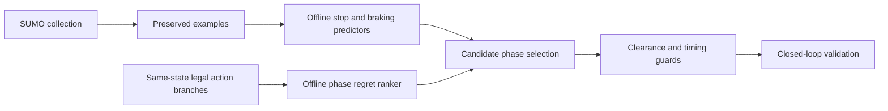

# Architecture and methodological choices

## Reusable-data control

Collection creates labeled examples once; many model fits can reuse them. Predictor
accuracy asks whether observed future behavior can be predicted. Action ranking
asks which intervention would improve outcomes. The paired-action corpus saves
the identical SUMO/Python state and continues every legal branch with a frozen
incumbent. This reduces ambiguity but still needs closed-loop validation because
control changes the later state distribution.

The later predictors use vehicle speed, acceleration, lane/queue relationships,
signal plans, and downstream receiving-lane context. Small MLPs trade some tree
accuracy for faster inference. A separate phase ranker learns regret, with whole
routes separated for training, selection validation, and final testing.

The earlier evolutionary branch emits noop/early/extend residuals with explicit
limits. Neuron alignment before crossover avoids combining arbitrary hidden-unit
orderings. A PCA specialist encoder is a predictive latent representation; this
portfolio does not claim an implemented JEPA model.

## Historical reconstruction

Recorded ATSPM signals are replayed rather than optimized during reconstruction.
Only configured count events create boundary demand; internal detectors constrain
the same vehicles rather than creating duplicates. Detector health/restoration
events and duplicate channels are distinguished from vehicle counts.

Anonymous pulses support uncertain associations. Matching maximizes coverage within
a tolerance and then minimizes error. Unmatched events remain penalized. Boundary
fit, trip completion, signal equivalence, warnings, collisions, teleports, and access
geometry constrain promotion. A better internal matched MAE is insufficient alone.

Neural inverse fitting proposes bounded driver changes from cumulative safe replay
data. A separate forward proof of concept predicts detector sequence/timing and
PCA-compressed local motion. Because surrounding traffic histories are supplied,
it does not solve arbitrary future simulation without context.

## Implementation scope

`code/` contains reusable, inspectable algorithms and offline fitting code.
`reference/` preserves full pipeline source from the pinned main revision. Those
reference programs require modules and datasets omitted from this compact repo;
do not run them as the demo. No raw ATSPM export, third-party network, model pickle,
or large simulation log is redistributed here.

AI-assisted implementation and review do not remove the need for domain validation.
The project's real-road safety and independent-day generalization remain open.
